# EKBPRO KNX Terminal Python – SCADA for KNX in the terminal

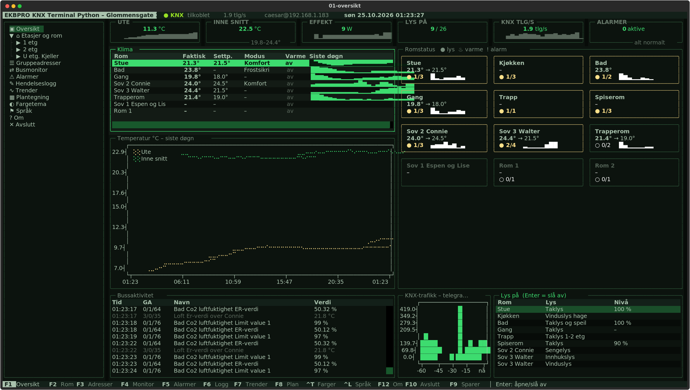

A SCADA and visualisation system for KNX that runs in the terminal and is used over SSH. Everything is built
automatically from the ETS project file (`.knxproj`), so **anyone can use it with their own installation**.
You need no web browser, no per-view licence and no special hardware.

**Features**

- **Visualisation per floor and room:** switches, dimmers, setpoints, operating modes and measurements with live status.
- **Overview:** status tiles (outdoor, indoor, power, lights, KNX traffic, alarms), climate table with sparklines, room status and charts.
- **Floor plan** of the building with live status per room. Can be exported to DXF for CAD programs.
- **Group addresses:** every address with its live value, search, reading and writing.
- **Bus monitor:** all telegrams live, with filter and pause (and the interface each came through). Export to
  ETS (group monitor XML), CSV or JSON – what is shown, or the last hour/day/week from the log.
- **Alarms:** rules from the configuration, acknowledgement and history.
- **Event log:** who operated what, and when.
- **Trends:** curves from the log (1 hour to 30 days) as line, step, filled or bar charts.
- **Screensaver** that rotates between information pages. Unacknowledged alarms take over the screen.
- **Six colour themes:** muted green, green phosphor, amber, modern dark, solarized and Storm Automasjon –
  chosen per installation, so several sites can be told apart. A company logo can replace the start-up logo.
- **Two languages:** English (default) and Norwegian bokmål – per installation, per user or per session.
- **One server, many clients:** one KNX tunnel per IP interface regardless of the number of SSH sessions, and logging around the clock.
- **Connectivity:** KNX IP tunneling (UDP and TCP), routing and KNX IP Secure with a keyring from ETS.
- **Several KNX IP interfaces** treated as one bus (one per line or building part), with routing of outgoing
  telegrams and de-duplication; reachable through NAT/VPN.
- **Several ETS projects in one site** (e.g. a main building and an annex), `.knxproj` and `.knxprojarchive`.
- **Rooms from group address names** for projects structured by function ("Actual temp Office 1").
- **PLC bridge over OPC UA:** a PLC (e.g. CODESYS on a WAGO PFC) reads and writes selected KNX addresses – the GVL is
  generated from the ETS project, optionally with names from system tags. Several PLCs per site. A PLC download or
  reset never reaches the bus.
- **Docker:** runs in a container, also on a WAGO PFC200/PFC300.

## Getting started

```bash
git clone https://github.com/espenbo/ekbpro-knx-terminal-python.git
cd ekbpro-knx-terminal-python
./setup.sh                                                   # installs everything
./scada init ~/MyHouse.knxproj --gateway 192.168.1.50        # your ETS project and IP interface
./scada server &                                             # starts the KNX connection
./scada                                                      # starts the visualisation
```

Without access to the installation you can try it with a simulated bus: `./scada server --demo`.

From another machine: `ssh -t user@server ~/ekbpro-knx-terminal-python/scada`

## Screenshots

Taken from a real installation, with the user interface in Norwegian (English is the default).

| | |
|---|---|
| 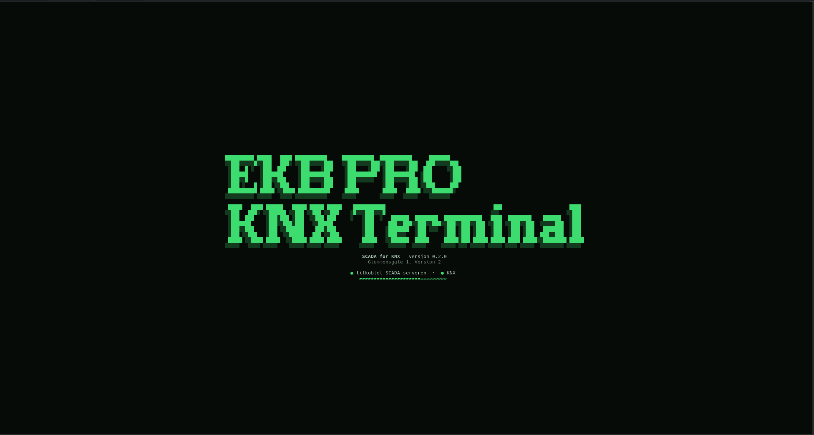 Start-up | 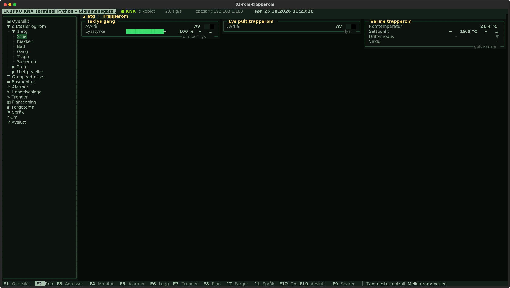 F2 Room |
| 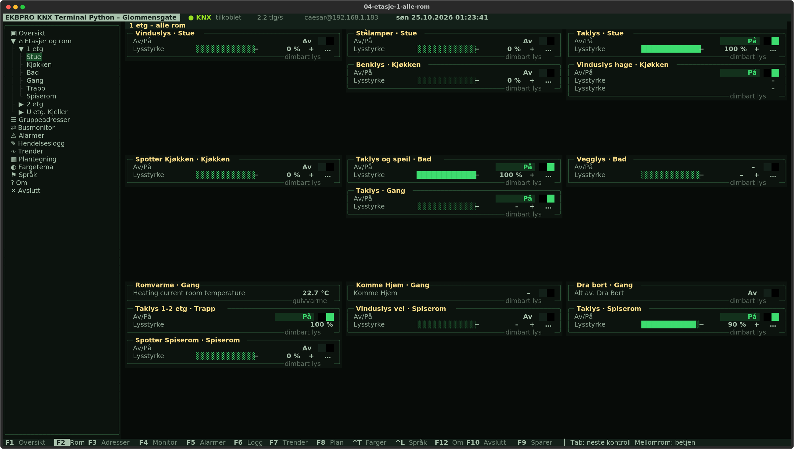 F2 All rooms of a floor | 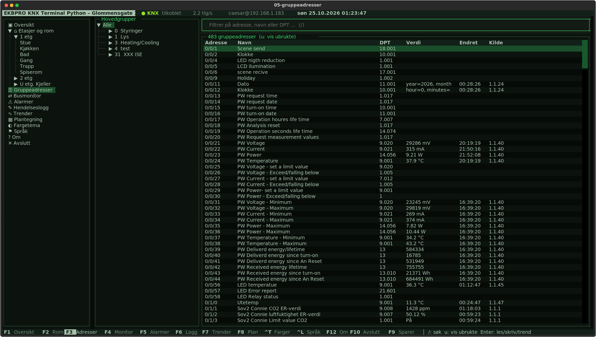 F3 Group addresses |
| 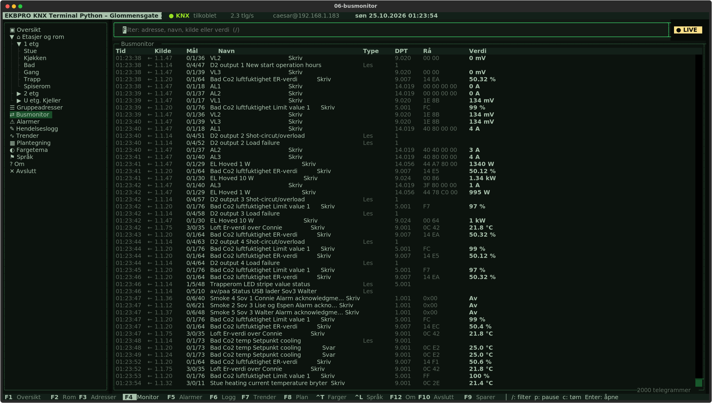 F4 Bus monitor | 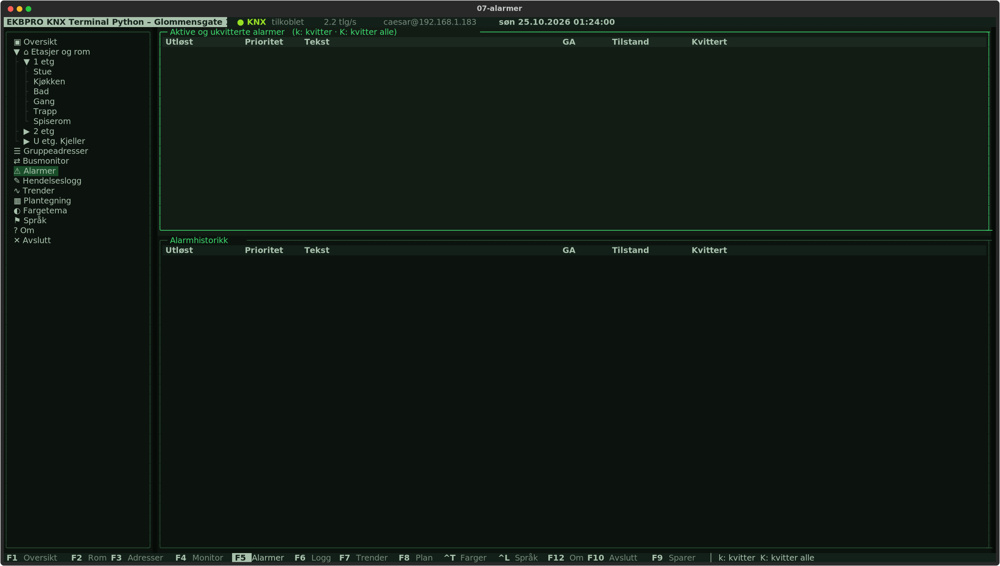 F5 Alarms |
| 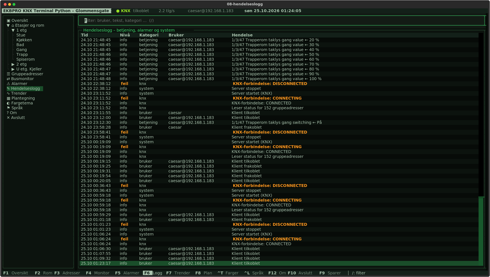 F6 Event log | 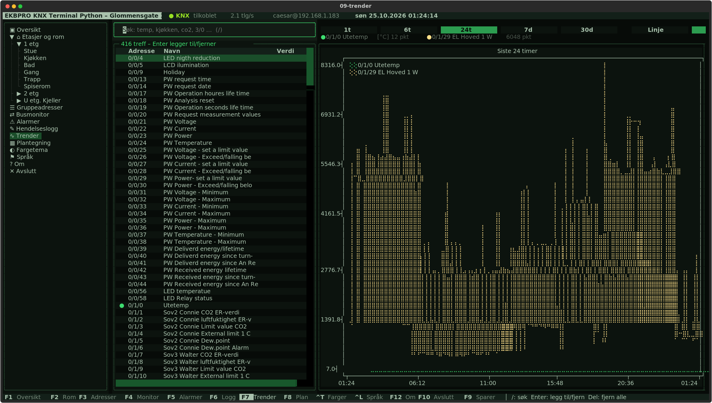 F7 Trends |
| 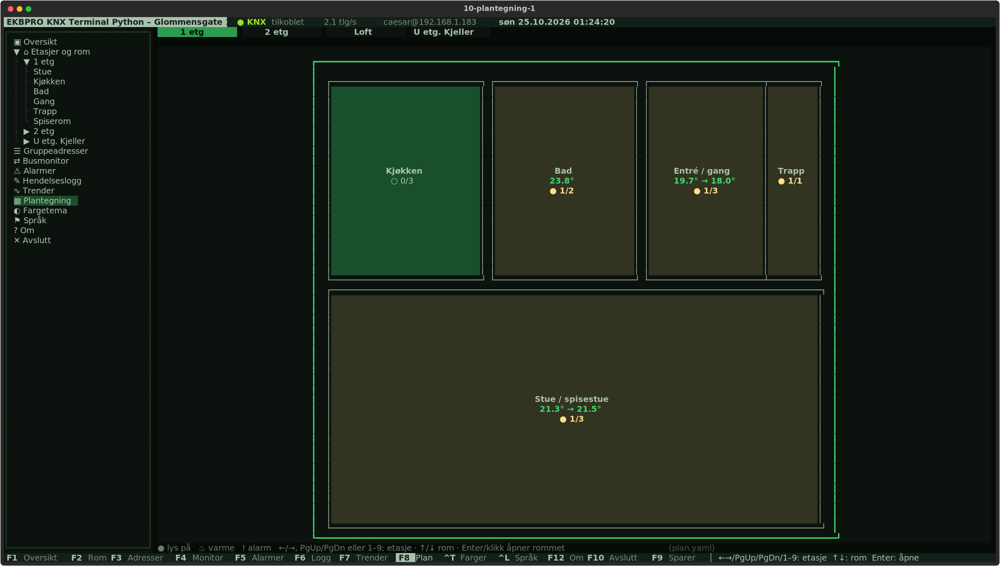 F8 Floor plan | 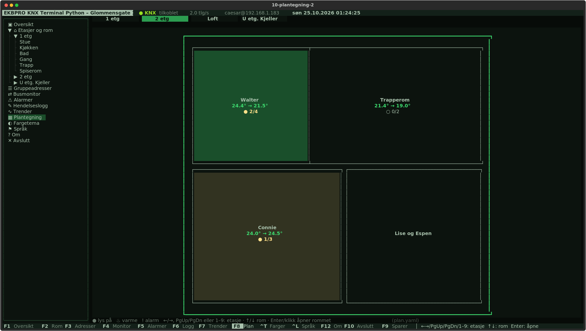 F8 Floor plan, next floor |
| 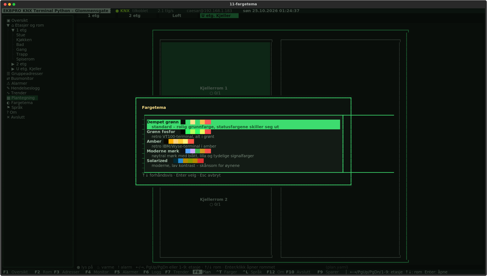 Ctrl+T Colour theme | 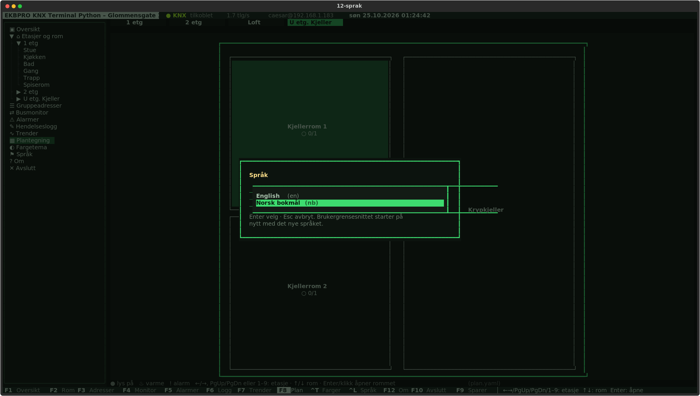 Ctrl+L Language |
| 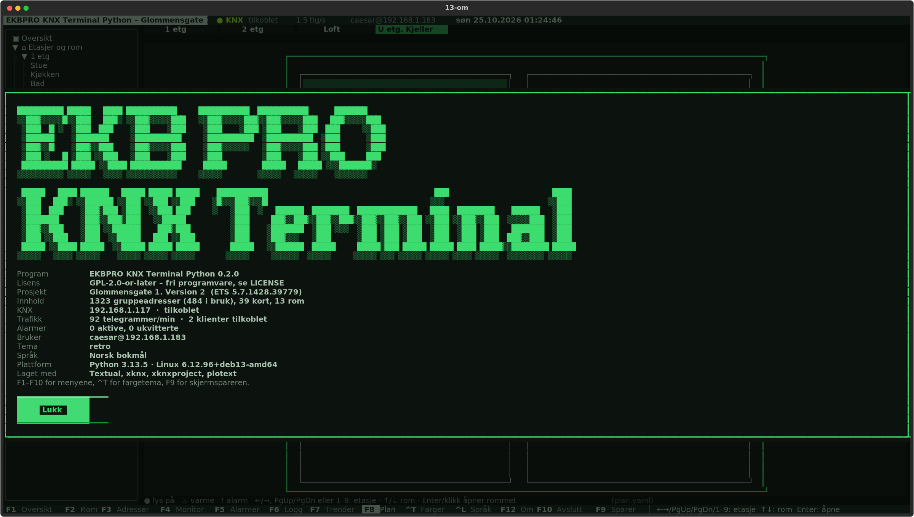 F12 About | 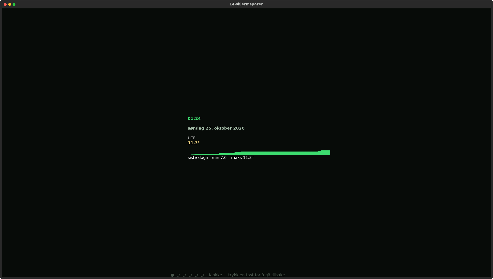 F9 Screensaver |

## Documentation

| Document | Contents |
|---|---|
| [Installation](docs/01-installation.md) | Requirements, installation, first test |
| [Using your own KNX project](docs/02-own-project.md) | Export from ETS, `init`, what makes a good visualisation, customisation, KNX Secure |
| [User guide](docs/03-user-guide.md) | All views, keys and functions |
| [Configuration](docs/04-configuration.md) | Complete reference for `config.yaml`: alarm rules, language, several KNX interfaces and ETS projects, rooms from names |
| [Operation and SSH](docs/05-operation-and-ssh.md) | systemd, multiple users, dedicated SSH user, security, backup |
| [Floor plan](docs/06-floor-plan.md) | `plan.yaml` and DXF export |
| [Troubleshooting](docs/07-troubleshooting.md) | Common problems and solutions |
| [Docker](docs/09-docker.md) | Running in a container, e.g. on a WAGO PFC200/PFC300 |
| [PLC bridge (OPC UA)](docs/10-plc-opcua.md) | Let a PLC read and write KNX: mapping, CODESYS GVL, security |
| [Architecture](docs/08-architecture.md) | For developers: components, protocol, database, translations, tests, extensions |

## Commands

| Command | Does |
|---|---|
| `./scada` | Starts the visualisation |
| `./scada tui [--language en\|nb]` | Starts the visualisation, optionally in another language for this session |
| `./scada server [--demo] [-v]` | Starts the server (KNX, logging, alarms) |
| `./scada init PROJECT.knxproj [--gateway IP] [--connection TYPE] [--password PW] [--language en\|nb] [--force]` | Creates `config.yaml` for a project |
| `./scada import` | Re-reads the `.knxproj` |
| `./scada info` | Shows a summary of the project |
| `./scada plan-dxf [file.dxf]` | Exports the floor plan to DXF |
| `./scada plc-map [--all\|--marked] [--rename] [--plc NAME]` | Creates/updates the PLC mapping (`plc_map.yaml`) and the CODESYS GVL, for every PLC or one |
| `./scada plc-browse [FILTER] [--endpoints] [--plc NAME]` | Lists the variables (or the security modes) of the PLC's OPC UA server |

All commands accept `-c path/to/config.yaml` (before the command). You can also set the environment variable
`KNXSCADA_CONFIG`.

## Keys at a glance

`F1` Overview · `F2` Rooms · `F3` Addresses · `F4` Monitor · `F5` Alarms · `F6` Log · `F7` Trends ·
`F8` Plan · `F9` Screensaver · `F10` Quit · `F12` About · `Ctrl+T` Colour theme · `Ctrl+L` Language · `/` Search

More in the [user guide](docs/03-user-guide.md).

## Development

Tests live in `tests/` and are run with pytest:

```bash
venv/bin/pip install -r requirements-dev.txt
venv/bin/python -m pytest
```

See [Architecture](docs/08-architecture.md) for the code structure and how to add translations.

## License

EKBPRO KNX Terminal Python is free software, licensed under the GNU General Public License, version 2 or (at your
option) any later version (GPL-2.0-or-later). See [LICENSE](LICENSE).
